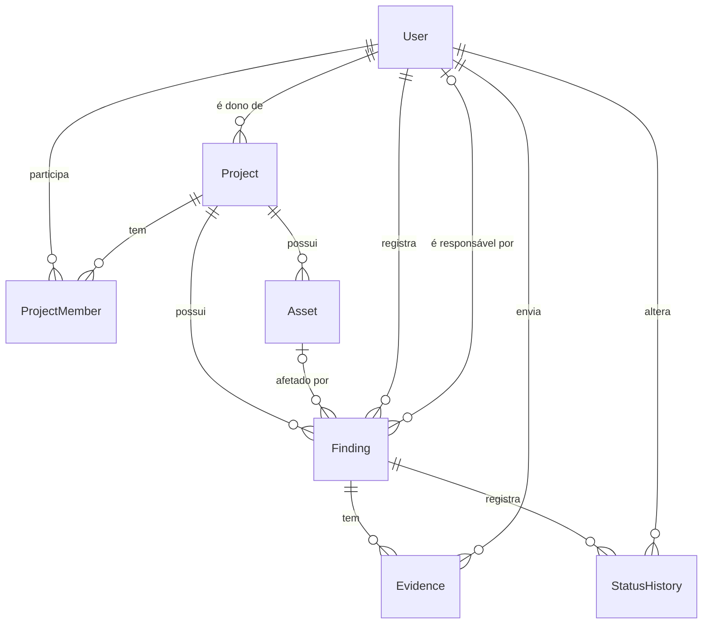
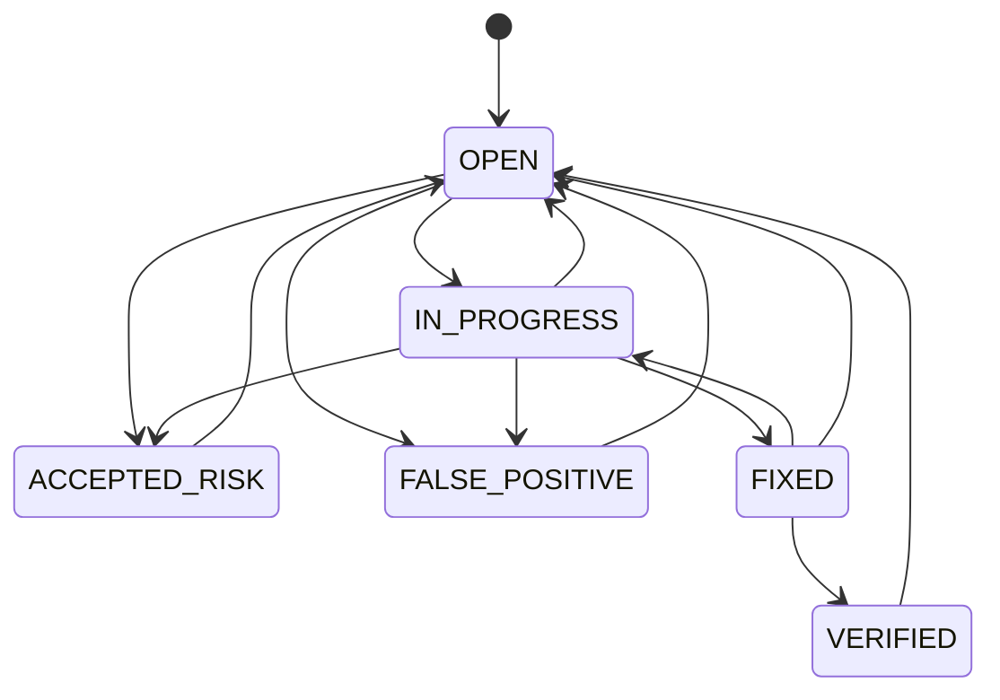

# Arquitetura

> Estado em 21/11/2026 (commit `932cbcb`). Este documento é um retrato do momento e vai mudar conforme o projeto avançar.

O VulnCase é, por enquanto, uma API REST em Node.js com TypeScript. Este documento explica como o backend foi organizado, como uma requisição percorre o código e como os dados são modelados.

## Visão geral

```
Cliente (futuro frontend)
        |
        v
   API Express 5  ------>  Redis (sessões)
        |
        v
  Prisma 7 (adaptador MariaDB)
        |
        v
     MySQL 8.4

  Disco local (pasta de uploads): arquivos de evidência
```

- **Express 5** recebe as requisições e organiza as rotas.
- **Prisma** faz o acesso ao MySQL. O client é gerado a partir do `schema.prisma` em `backend/src/generated/prisma`, pasta que não vai para o git, então é preciso rodar `npx prisma generate` depois de clonar.
- **Redis** guarda as sessões dos usuários.
- Os **arquivos de evidência** ficam no disco. O banco guarda só os metadados (nome original, tipo, tamanho) e o nome gerado pelo servidor.
- O projeto usa módulos ES (`"type": "module"`), por isso os imports terminam em `.js`.

## Estrutura de pastas

```
backend/src/
├── main.ts            conecta no Redis e sobe o servidor
├── app.ts             monta o Express e a ordem dos middlewares globais
├── routes/            junta as rotas de todos os recursos
├── resources/         um módulo por recurso do sistema
│   ├── auth/
│   ├── projects/
│   ├── assets/
│   ├── members/
│   ├── findings/
│   ├── evidence/
│   ├── stats/
│   └── catalog/
├── middlewares/       peças reutilizáveis, aplicadas nas rotas
├── lib/               conexões e infraestrutura (prisma, redis, storage)
└── utils/             funções de apoio (erros, paginação, datas, env)
```

## Como cada recurso é organizado

Cada pasta em `resources/` segue o mesmo padrão, o que facilita achar as coisas:

| Arquivo | Responsabilidade |
| --- | --- |
| `*.router.ts` | Define as rotas e a ordem dos middlewares de cada uma |
| `*.controller.ts` | Lê a requisição, chama o service e devolve a resposta. Não tem regra de negócio |
| `*.service.ts` | Regras de negócio e acesso ao banco com Prisma |
| `*.schema.ts` | Regras de validação da entrada, escritas com zod |
| `*.types.ts` | Tipos do TypeScript, derivados dos schemas |

Alguns recursos têm arquivos extras para isolar uma regra específica:

- `findings.transitions.ts`: a tabela de mudanças de status permitidas, separada do service para ficar fácil de ler e de testar.
- `evidence.detect.ts` e `evidence.upload.ts`: detecção do tipo real do arquivo e configuração do multer.
- `catalog.data.ts`: os dados do catálogo OWASP e CWE, guardados no código e não no banco, já que são dados de referência que quase não mudam.

## Como uma requisição percorre o código

Os middlewares globais do `app.ts` rodam sempre, nesta ordem: helmet (cabeçalhos de segurança), CORS, leitura do JSON (limite de 100 KB), log com morgan, cookies, sessão e proteção CSRF. Depois vêm as rotas, o tratador de rota inexistente (404) e, por último, o tratador de erros.

Para ver o caminho completo, o exemplo de `PATCH /projects/:projectId/findings/:findingId/status` (mudar o status de um achado):

1. **Middlewares globais:** sessão carregada do Redis e token CSRF conferido.
2. **`requireAuth`:** confirma que há um usuário logado e carrega os dados dele.
3. **Validação dos parâmetros:** o `projectId` precisa ser um UUID válido.
4. **`requireProjectAccess`:** o usuário precisa ser membro do projeto (ou administrador). Se não for, recebe 404, como se o projeto não existisse.
5. **Validação dos parâmetros do achado e `requireRole`:** só administrador e analista escrevem. Visualizador é barrado aqui.
6. **Validação do corpo:** o novo status precisa ser um dos valores válidos.
7. **Controller:** repassa os dados ao service.
8. **Service:** busca o achado dentro do projeto, confere se a transição é permitida, atualiza o status e grava o histórico numa única transação.
9. **Resposta:** o achado atualizado volta em JSON.

Se qualquer etapa falhar, ela lança um erro. O Express 5 encaminha erros de funções assíncronas automaticamente, então os controllers, em geral, não precisam de `try/catch`. O tratador de erros do `middlewares/errorHandler.ts` converte cada tipo de erro numa resposta padronizada:

- erro de negócio (`AppError`) vira o status escolhido por quem lançou (401, 403, 404, 409...)
- erro de validação do zod vira 400, com o campo e a mensagem de cada problema
- token CSRF inválido vira 403
- problemas de upload (arquivo grande demais, campo errado) viram 413 ou 400
- registro inexistente no Prisma vira 404
- qualquer outro erro vira 500, com a mensagem genérica na resposta e o detalhe só no log

O formato de erro é sempre `{ "error": "mensagem", "details": [...] }`, sendo `details` opcional.

### Detalhes de implementação

- O middleware `validate` substitui `req.body` e `req.params` pelos dados já validados. Como o zod descarta campos desconhecidos, isso também evita que o cliente grave campos que não deveria, como o status ou o autor de um achado.
- No Express 5 o `req.query` é somente leitura, então o `validate` redefine essa propriedade em vez de atribuir.
- As rotas são aninhadas e usam `mergeParams`, para que `assets`, `members`, `findings` e `stats` enxerguem o `:projectId` definido no router de projetos.
- Listagens usam paginação padronizada: `page` e `pageSize` (padrão 10, máximo 100) e resposta no formato `{ data, meta }`.

## Mapa de rotas

| Prefixo | Recurso |
| --- | --- |
| `/health` e `/csrf-token` | Verificação da API e obtenção do token CSRF |
| `/auth` | Cadastro, login, logout e usuário logado |
| `/projects` | Projetos |
| `/projects/:projectId/assets` | Ativos do projeto |
| `/projects/:projectId/members` | Membros do projeto |
| `/projects/:projectId/findings` | Achados do projeto |
| `/projects/:projectId/findings/:findingId/evidence` | Evidências do achado |
| `/projects/:projectId/stats` | Números do projeto |
| `/stats` | Visão geral de todos os projetos do usuário |
| `/catalog` | Catálogo OWASP e CWE |

A lista completa de endpoints e permissões fica em [`api.md`](api.md).

## Modelo de dados



| Modelo | Campos principais | Observações |
| --- | --- | --- |
| `User` | e-mail (único), nome, senha, papel | A senha guarda só o hash. Papéis: administrador, analista e visualizador |
| `Project` | nome, descrição, dono | O criador vira dono e primeiro membro |
| `ProjectMember` | projeto e usuário | Chave composta. Define quem enxerga o projeto |
| `Asset` | nome, tipo, identificador | Tipos: web, mobile, rede e código |
| `Finding` | título, descrição, severidade, status, correção proposta, OWASP, CWE, CVE, prazo | Ativo e responsável são opcionais. Guarda também quem registrou |
| `Evidence` | nome gerado, nome original, tipo, tamanho | Pertence a um achado e guarda quem enviou |
| `StatusHistory` | status anterior, novo status, quem mudou | O status anterior é nulo no registro de criação |

Os identificadores são UUIDs. Há índices nas consultas mais comuns (achados por projeto e status, por projeto e severidade, por responsável e por ativo).

### O que acontece quando algo é excluído

- Excluir um **projeto** apaga em cascata membros, ativos, achados, evidências e histórico.
- Excluir um **achado** apaga evidências e histórico.
- Excluir um **ativo** não apaga os achados dele, que apenas ficam sem ativo.
- Quando um **membro** sai do projeto, os achados sob responsabilidade dele ficam sem responsável.
- Como o banco só remove os registros, o código também apaga do disco os arquivos das evidências quando um achado ou projeto é excluído.

## Ciclo de vida de um achado

Todo achado nasce como `OPEN` e só muda de status pelo endpoint próprio, que valida a transição e grava o histórico. A edição comum do achado não altera o status.



Legenda: `OPEN` aberto, `IN_PROGRESS` em andamento, `FIXED` corrigido, `VERIFIED` verificado, `ACCEPTED_RISK` risco aceito e `FALSE_POSITIVE` falso positivo.

Nas estatísticas e nos filtros, um achado "ainda aberto" é o que está em `OPEN` ou `IN_PROGRESS`. Um achado `FIXED` já foi corrigido e só aguarda a verificação, por isso não conta como pendente. "Vencido" é um achado ainda aberto com prazo no passado, e "parado" é um achado ainda aberto há mais de N dias (30 por padrão).

Para evitar conflito, a mudança de status só é aplicada se o status ainda for o mesmo que foi lido. Se outra pessoa mudou nesse meio tempo, a API responde 409.

## Infraestrutura de desenvolvimento

- O `backend/compose.yaml` sobe o MySQL 8.4 e o Redis 8, ambos expostos só em `127.0.0.1`. As senhas vêm do arquivo `.env`.
- O `backend/Dockerfile` tem quatro estágios (build, desenvolvimento, testes e produção). O de produção instala só as dependências de produção e roda com o usuário `node`, sem privilégios de root.
- A CI e os hooks do Git estão descritos no [`README.md`](../README.md).